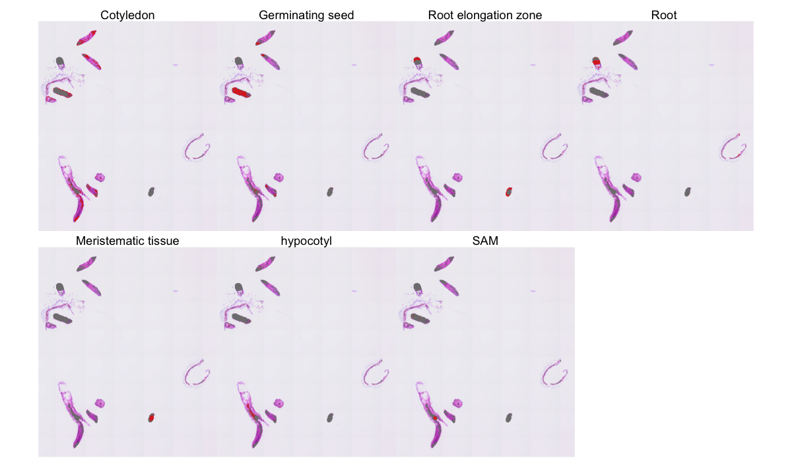
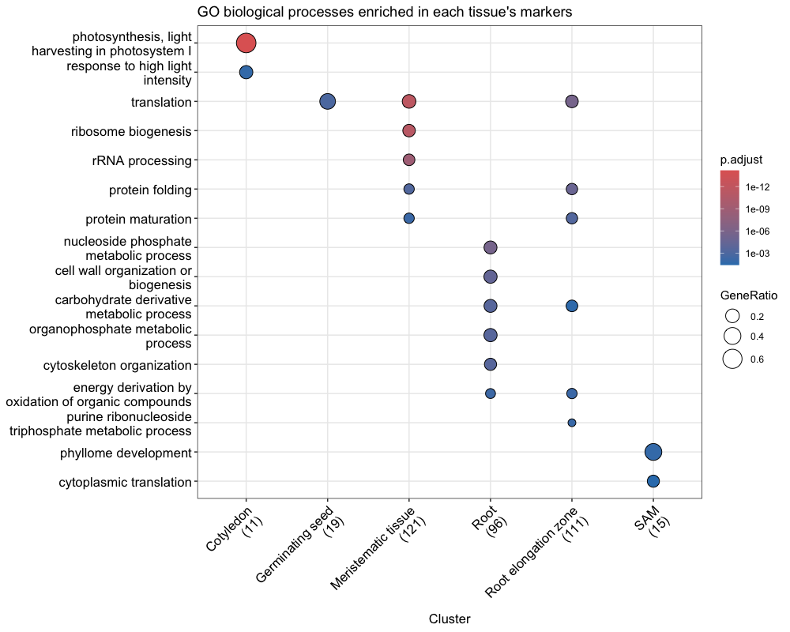

# Spatial transcriptomics of Arabidopsis seedlings (Visium HD): a step-by-step reproduction

This project re-runs a published Visium HD analysis of *Arabidopsis thaliana* seedlings from start to
finish in R/Seurat. It explains every step: what it does, why it is done that way, and what came out.
It fixes the bugs in the original scripts and reports the numbers this run actually produced,
including where they differ from the original.

**➡ Read the full notebook: [arabidopsis_analysis.md](arabidopsis_analysis.md)**
(source: [arabidopsis_analysis.Rmd](arabidopsis_analysis.Rmd))

## The analysis in brief

| Step | What it does | Result in this run |
|---|---|---|
| 3. Load | Read the 8 × 8 µm bins into Seurat | 31,109 genes × 7,356 bins |
| 4. Quality control | Remove bins with ≤ 100 molecules or ≤ 50 genes | 17,852 genes × 1,516 bins |
| 6. Clustering | PCA → neighbour graph → Louvain clustering | 7 clusters |
| 7. Annotation | Name clusters from their marker genes | Cotyledon, germinating seed, root elongation zone, root, meristematic tissue, hypocotyl, SAM |
| 8. Spatial genes | Moran's I for 3,000 variable genes | Top gene: EXT3 (I = 0.79), expressed along the whole root |
| 9. Differential expression | Cotyledon vs germinating seed (Wilcoxon) | 331 genes tested; 50 significant with a ≥ 2-fold change (1 up in cotyledon, 49 up in germinating seed) |
| 10. GO enrichment | ORA per tissue + GSEA | Photosynthesis (cotyledon), ribosome biogenesis (meristem), cell wall (root), phyllome development (SAM) |
| 11. Gradients | GAM of expression vs distance from the SAM | AFO and ANT confined to the SAM region; CAB1 shows no trend |

## What this reproduction corrects

Everything up to clustering matches the original exactly. The later differences have reasons:

- **The spatially variable gene list.** The original scaled only ~35 heat-map genes, so Moran's I
  could only test those. Here all 3,000 variable genes are tested. EXT3 is still first, but AGP31
  drops from 2nd to 5th.
- **"DEG" counts.** The original reports the number of genes *tested* as differentially expressed
  genes. Here tested, significant, and significant with a two-fold change are reported separately:
  331, 208 and 50.
- **Tissue-specific GO cut-offs.** In the original they never took effect, because of a numbers vs
  names mismatch. With them applied, hypocotyl has no significant GO terms. Its 5 terms in the
  original came from just 2 genes.
- **Gradient interpretation.** ANT is described in the original as a "modest gradient". In the
  plots it is confined to a small domain around the SAM, like AFO.

The notebook's *Summary* section lists every bug fixed and every problem hit while running it.

## How to reproduce

1. Install a recent R (this run used R 4.6.1) and RStudio, then open `arabidopsis_visium.Rproj`.
2. In `arabidopsis_analysis.Rmd`, run the **Step 1** chunk (installs packages) and the **Step 2**
   chunk (downloads the 768 MB dataset from 10x Genomics) once, using the green ▶ on each chunk.
3. Press **Knit**. The whole analysis takes about one minute.

The raw data are not stored in this repository (see `.gitignore`). Step 2 downloads them.

## Files

| File | Contents |
|---|---|
| `arabidopsis_analysis.Rmd` | The analysis notebook, with explanations |
| `arabidopsis_analysis.md` + `arabidopsis_analysis_files/` | The knitted notebook and its figures, readable on GitHub |
| `results/DE_cot_vs_germ.csv` | Differential expression table, cotyledon vs germinating seed |
| `arabidopsis_visium.Rproj` | RStudio project file (sets the working directory) |

## Credits

- **Original analysis:** Anita Shrestha,
  [ashrest58-commits/arabidopsis-visium-hd-spatial-transcriptomics](https://github.com/ashrest58-commits/arabidopsis-visium-hd-spatial-transcriptomics)
  (MIT licence).
- **Data:** 10x Genomics public dataset *Visium HD 3′ Arabidopsis* (Space Ranger 4.0.1 outputs).
- **Software:** Seurat, clusterProfiler, org.At.tair.db, enrichplot, mgcv, ggplot2. Exact versions
  are at the end of the notebook.
